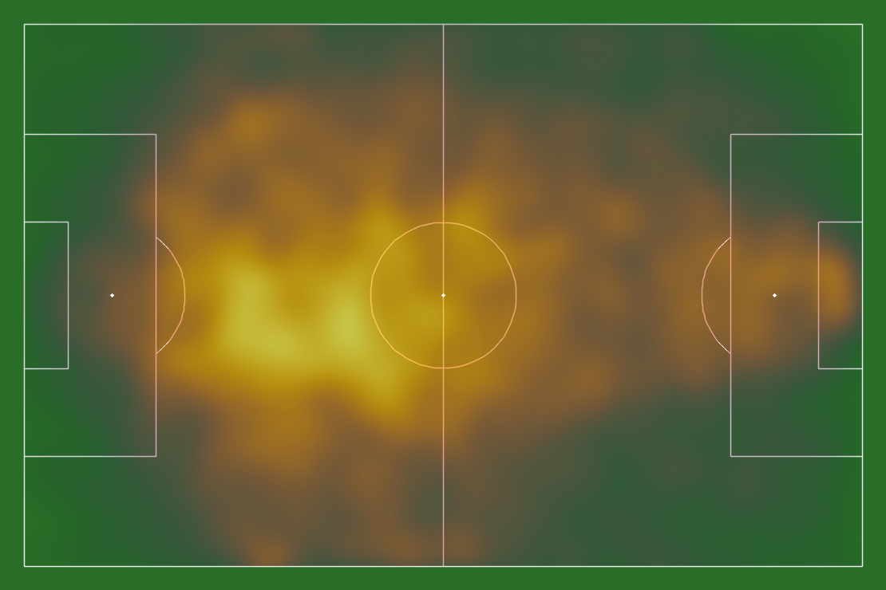
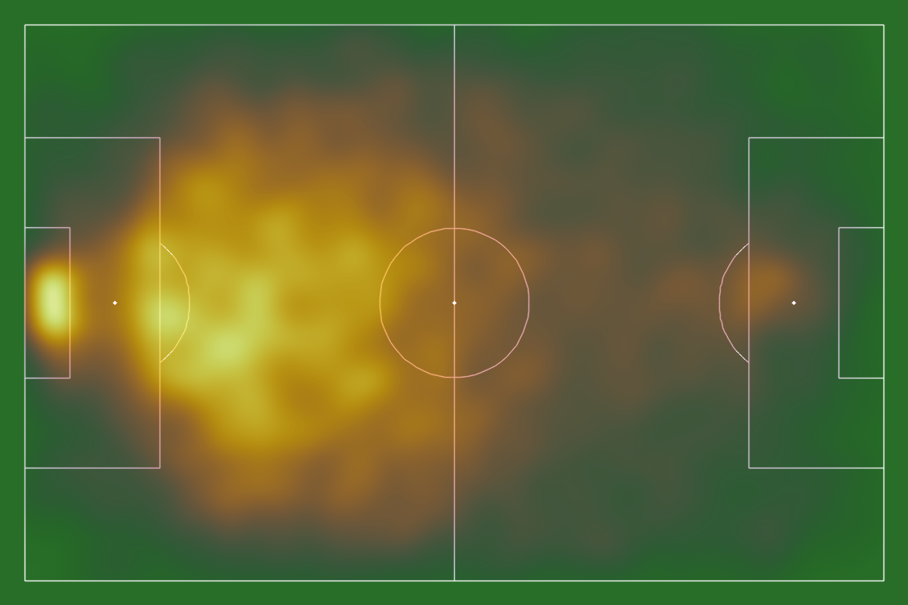

# Mapas de calor de jogadores a partir de vídeo de transmissão

Projeto final de **GDSCO0055 – Introdução ao Processamento Digital de Imagens** (UFPB, 2026.2,
Prof. Leonardo Vidal Batista). Autor: Guilherme Nogueira da Silva.

O pipeline recebe o vídeo de uma transmissão de futebol e gera, para cada time, o mapa de onde os jogadores
passaram mais tempo, visto de cima. A rede neural (YOLO) é usada **só para detectar pessoas**. Todo o resto
(gramado, times, linhas do campo, câmera, mapa) é feito com técnicas clássicas de PDI, com cada parâmetro
justificado por medição em `configs/default.yaml`.

| Barcelona | Real Madrid |
|---|---|
|  |  |

*Final da Copa del Rey: 148 tomadas da câmera principal, 55 min de jogo. O Barcelona ataca para a esquerda.*

## Resultados principais

| O que | Resultado | Onde |
|---|---|---|
| Mapa por time vs. mapa feito com as posições reais (SoccerNet) | correlação 0,98 e 0,97 | clip01 |
| Erro dos pés projetados no campo (homografia manual) | 0,58 m (mediana) | clip01 |
| Times pela cor (histograma H-S + k-means + votação de 1 s) | acurácia 0,999 | clip01 |
| Detecção (YOLO11n + filtro do gramado) | recall 0,933, precisão 0,948 | clip01 |
| Goleiro pela posição (com posições e IDs do gabarito) | 54 de 56 goleiros achados; 57 de 59 IDs com o time certo | 58 sequências do GSR |
| Separação das tomadas da câmera principal | F1 0,977 | Liverpool × City |
| Câmera reencontrada sem marcação (deixando cada marcação de fora) | 3,8 px de erro mediano (clique manual: 2,6 px) | Liverpool × City |
| Quadros aceitos sem marcação que são câmera principal | 99,5% | Liverpool × City |
| Tempo da câmera principal no mapa | 95% (55,1 min) e 91% (58,0 min) | final; Liverpool |
| Confiabilidade do mapa (metades + Spearman–Brown) | 0,95 com 148 tomadas | final |

Os números e a discussão completa estão no relatório (PDF entregue à parte).

## Como funciona

```
vídeo → tomadas (câmera principal ao vivo) → gramado → pessoas (YOLO) → rastreamento (ByteTrack)
      → time pela cor → câmera do quadro (linhas do campo) → pé projetado no campo → grade → suavização → cor
```

| Etapa | Técnica | Módulo | Conteúdo da disciplina |
|---|---|---|---|
| Tomadas | Distância de Bhattacharyya entre histogramas HSV de quadros vizinhos; presença do placar por casamento de padrões | `src/shots.py` | Histograma; correlação |
| Gramado | Limiar em HSV, abertura/fechamento, maior componente conexo | `src/field_mask.py` | Sistemas de cores; operações pontuais |
| Pessoas | YOLO11n (classe `person`), só com o pé sobre o gramado | `src/detection.py` | (única rede neural) |
| Rastreamento | ByteTrack | `src/tracking.py` | — |
| Times | Histograma H-S do tronco sem grama, k-means (k = 2), votação em janela de 1 s | `src/team_classifier.py` | Processamento de histograma |
| Linhas do campo | *Top-hat* morfológico na luminância e transformada de distância | `src/lines.py` | Operações locais |
| Câmera | Câmera de centro fixo (só gira e dá zoom), ajustada às linhas em cada quadro; busca exaustiva quando se perde | `src/camera.py`, `src/homography.py`, `src/lines.py` | Transformações geométricas |
| Mapa | Pé da caixa projetado no campo, grade de 0,5 m, gaussiana de σ = 2 m (no espaço e na frequência), colormap | `src/heatmap.py`, `src/pitch.py` | Amostragem; convolução; DFT; pseudocor |
| Partida | Junta tudo; lado de cada time pelo último defensor; goleiro pela posição; descarta quadros com pessoas fora do campo | `src/match.py` | — |

A câmera de centro fixo e a busca exaustiva seguem os sistemas clássicos de transmissão (Thomas, BBC, 2007;
Beetz et al., ASPOGAMO, 2007), reimplementados aqui com morfologia e transformada de distância no lugar de
detectores aprendidos. Os trabalhos relacionados e o que foi aproveitado de cada um estão no relatório.

## Instalação

```bash
python -m venv .venv && source .venv/bin/activate
# torch primeiro (fora do requirements.txt, depende da máquina):
pip install torch torchvision --index-url https://download.pytorch.org/whl/cpu     # sem GPU
# pip install torch torchvision --index-url https://download.pytorch.org/whl/cu128 # GPU NVIDIA
pip install -r requirements.txt
# pesos do YOLO (~5 MB) em models/:
cd models && python -c "from ultralytics import YOLO; YOLO('yolo11n.pt')" && cd ..
pytest -q
```

Tudo roda em CPU. Uma partida completa leva algumas horas na primeira vez (a detecção domina); depois tudo
fica em cache em `outputs/<partida>/` e uma nova rodada leva cerca de 2 min.

## Dados

Vídeos e pesos não são versionados (`data/raw/`, `data/clips/`, `models/` estão no `.gitignore`).

**SoccerNet Game State Reconstruction** (`gamestate-2024`, split `valid`): sequências de 30 s com a posição de
cada pessoa na imagem e no campo, time e papel. Usado para medir cada etapa.

```python
from SoccerNet.Downloader import SoccerNetDownloader
SoccerNetDownloader(LocalDirectory="data/raw/SoccerNetGS").downloadDataTask(task="gamestate-2024", split=["valid"])
# depois: unzip data/raw/SoccerNetGS/gamestate-2024/valid.zip -d data/raw/SoccerNetGS/valid
```

| Dado | Origem | Uso |
|---|---|---|
| `data/clips/clip01.mp4` | SNGS-056 (pênalti, 750 quadros), recodificado com `cv2.VideoWriter` | Desenvolvimento e validação de cada etapa: menor movimento de câmera do split e grande área inteira visível |
| Liverpool 3 × 0 Manchester City (Premier League 2015-16) | SoccerNet (vídeos em 720p exigem a senha do NDA), com `Labels-cameras.json` | Partida inteira com gabarito de câmera: valida as tomadas e o acompanhamento da câmera |
| Barcelona × Real Madrid, final da Copa del Rey 2025 | Transmissão de TV, 1024×576, 30 fps (não distribuída) | Partida inteira principal |

Para o Liverpool × City (substitua a senha recebida ao aceitar o NDA do SoccerNet):

```python
from SoccerNet.Downloader import SoccerNetDownloader
d = SoccerNetDownloader(LocalDirectory="data/raw/SoccerNet"); d.password = "SENHA_DO_NDA"
d.downloadGame(game="england_epl/2015-2016/2016-03-02 - 23-00 Liverpool 3 - 0 Manchester City",
               files=["1_720p.mkv", "2_720p.mkv", "Labels-cameras.json", "Labels-v2.json"])
```

As coordenadas do SoccerNet têm origem no centro do campo; aqui a origem é o canto superior esquerdo, com X ao
longo do comprimento (somar L/2 e W/2).

## Uso

### Um clipe com câmera quase parada

```bash
python scripts/annotate_homography.py data/clips/clip01.mp4     # marca >= 4 pontos do campo
python scripts/run_pipeline.py data/clips/clip01.mp4            # mapas em outputs/clip01/
# métricas e figuras contra o gabarito do SoccerNet (outputs/figures/):
GT=data/raw/SoccerNetGS/valid/SNGS-056/Labels-GameState.json
python scripts/evaluate.py homography data/annotations/clip01.json --gt $GT
python scripts/evaluate.py team data/clips/clip01.mp4 --gt $GT
python scripts/evaluate.py heatmap data/clips/clip01.mp4 --gt $GT
python scripts/evaluate.py goleiro             # regra do goleiro nas 58 sequências de validação do GSR
```

### Uma partida completa

Cada partida é descrita por um JSON em `data/annotations/` (veja `barcelona-x-real_madrid.json`): o vídeo de
cada tempo, início e fim do jogo (mm:ss, pelo relógio da transmissão), um recorte do placar e a medida do campo.

```bash
M=data/annotations/barcelona-x-real_madrid.json
python scripts/segment_match.py $M              # 1. tomadas; marca quais são da câmera principal ao vivo
python scripts/annotate_homography.py --match $M  # 2. marca pontos do campo nas tomadas, da mais longa para a mais curta
python scripts/run_match.py $M                  # 3. câmera de cada quadro, times, lados e mapas
python scripts/demo_video.py $M --segundos 60 --nomes "Barcelona,Real Madrid" -o outputs/videos/demo_final.mp4
python scripts/conv.py $M                       # quantas tomadas bastam (Spearman–Brown)
# com gabarito de câmera do SoccerNet (só o Liverpool × City):
python scripts/evaluate.py shots data/annotations/liverpool-x-manchester_city.json
python scripts/evaluate.py camera data/annotations/liverpool-x-manchester_city.json
```

Não é preciso marcar todas as tomadas. As marcações servem para estimar a posição da câmera da transmissão
(ajuste conjunto de todos os cliques); as tomadas sem marcação têm a câmera encontrada pela busca exaustiva.
Na final, 39 tomadas marcadas bastaram para as 148. A ferramenta de marcação tem
teclas para desfazer (`u`, `z`), pular (`n`) e andar no vídeo (`a`, `d`); a lista está no topo de
`scripts/annotate_homography.py`.

Saídas em `outputs/<partida>/`: `heatmap_time0.png`, `heatmap_time1.png`, `heatmap_diferenca.png`,
`visibilidade.png` (quanto cada região do campo aparece na transmissão), `times_recortes.png`, `cameras.json`
e `run_match.log`. As figuras finais estão em `outputs/figures/final/`.

## Estrutura

```
configs/default.yaml      todos os parâmetros, com a medição que justifica cada um
data/annotations/         JSON de cada partida, marcações de homografia, recortes do placar
src/                      um módulo por etapa (tabela acima)
scripts/                  marcação, execução, avaliação e vídeo demo
tests/                    testes das funções determinísticas (pytest)
notebooks/                exploração da máscara do gramado
outputs/figures/final/    mapas finais das duas partidas
```

## Limitações

- O mapa mostra o jogo **que a transmissão mostrou**: a câmera principal segue a bola, e cada quadro mostra
  cerca de 30% do campo e metade dos jogadores.
- O árbitro, de preto, cai no grupo do time de uniforme escuro. Os goleiros são atribuídos pela posição.
- O YOLO pré-treinado perde jogadores pequenos na câmera mais aberta, e a bola fica fora.
- Parte das tomadas ainda precisa de marcação manual, para estimar a posição da câmera de cada estádio.
- A detecção é o gargalo em CPU (cerca de 110 ms por quadro).
